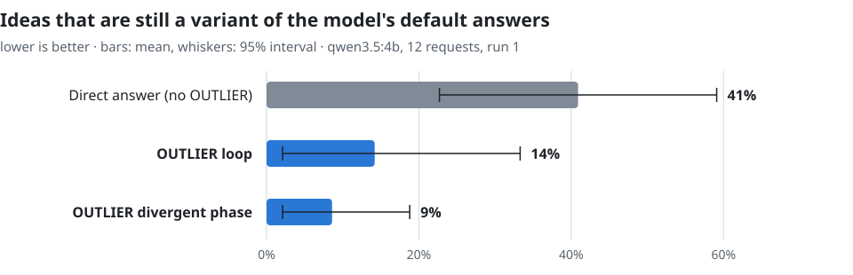

<picture>
  <source media="(prefers-color-scheme: dark)" srcset="docs/assets/hero-dark.svg">
  
</picture>

<p align="center">
  <a href="https://github.com/massimiliano-caretti/OUTLIER_MCB/actions/workflows/ci.yml"></a>
  
  
  
  <a href="LICENSE"></a>
  
</p>

<p align="center">
  <a href="#try-it-in-60-seconds"><b>Try it</b></a> ·
  <a href="docs/MANUAL.md"><b>Manual</b></a> ·
  <a href="#how-it-works">How it works</a> ·
  <a href="#what-it-has-been-measured-to-do">Evidence</a> ·
  <a href="docs/REFERENCE.md">Reference</a>
</p>

---

Ask a language model for *"a new rate limiter"* and it answers **token bucket**, **sliding window**, **leaky
bucket**: its default answers. Different models converge on the same few answers to open questions
([Artificial Hivemind](https://arxiv.org/abs/2510.22954), NeurIPS 2025).

**OUTLIER_MCB** is a Python library that does three things about it:

1. makes the model **state its default answers**, and treats them as the box to leave;
2. pushes it out along a **named hidden assumption**, with techniques taken from the research on LLM diversity;
3. lets an **external test** decide what survives (prior-art search, a test that must go RED→GREEN, a prover),
   never the model's opinion of its own idea, and **caps every claim** at what that evidence supports.

It works **offline with no model at all**, with **local models** (Ollama, llama.cpp, vLLM) and with **online models**
(Claude, OpenAI, Gemini, OpenRouter, Mistral, DeepSeek, Groq).

---

## Try it in 60 seconds

```bash
git clone https://github.com/massimiliano-caretti/OUTLIER_MCB.git
cd OUTLIER_MCB && pip install -e .
```

**1 · No model needed: judge two ideas.**

```bash
python -m OUTLIER_MCB judge --problem "invent a new rate limiter" \
       --idea "use a token bucket per client"

python -m OUTLIER_MCB judge --problem "invent a new rate limiter" \
       --idea "price each request by the queue variance it adds
               instead of counting requests per time window"
```

```text
verdict: INSIDE_THE_BOX    → a re-skin of the default answer
verdict: MUST_BE_AUDITED   → breaks 'time_windowed': worth testing,
                             and the report names the test that would kill it
```

**2 · With a model on your machine** ([Ollama](https://ollama.com)):

```bash
ollama pull qwen3:8b
python -m OUTLIER_MCB llm-search --llm ollama:qwen3:8b \
       --problem "invent a new way to rate-limit API clients"
```

**3 · With an online model:**

```bash
pip install -e ".[claude]"        # Claude, official SDK (ANTHROPIC_API_KEY)
python -m OUTLIER_MCB llm-search --llm claude: \
       --problem "invent a new way to rate-limit API clients"

# OpenAI-compatible APIs read their own key: OPENAI_API_KEY, GEMINI_API_KEY, …
python -m OUTLIER_MCB llm-search --llm openai:<model> --problem "…"
python -m OUTLIER_MCB llm-search --llm gemini:<model> --problem "…"
```

> [!TIP]
> New here? The **[manual](docs/MANUAL.md)** takes you from zero to a model-driven run in short lessons, each with
> the real output you should see.

---

## How it works

<picture>
  <source media="(prefers-color-scheme: dark)" srcset="docs/assets/pipeline-dark.svg">
  
</picture>

| step | what the library does | where it comes from |
|---|---|---|
| **1 · Name the box** | asks the model for its default answers; every later idea is measured against them (`MODE_ECHO` / `NEAR_MODE` / `TAIL`) | the *Artificial Hivemind* finding |
| **2 · Break an assumption** | domain **packs** list the assumptions every standard solution shares; ideas must break one on a named axis | the core of the engine |
| **3 · Diverge** | independent calls from distant points of view, each writing observations and then short intents, sampled hot | Intent Factored Generation (ICML 2025), PlanSearch (ICLR 2025), persona studies |
| **4 · Converge** | each intent is developed cool into a full candidate; a drift back to a default is retried once | measured on a local model (below) |
| **5 · Falsify** | prior-art audit, novelty and duplicate filters, a test that must go RED→GREEN, provers for math | OMNI-EPIC, MAP-Elites, FunSearch-style external evaluation |
| **6 · Honest claim** | the verdict is capped by the evidence: `INSIDE_THE_BOX` → … → verified useful novelty | the honesty ladder |

Everything is decomposed and inspectable: each verdict carries the evidence behind it, and the report states which
levers a model really used (for example, current Claude models do not accept a temperature, and the report says
so).

---

## Pick your path

| I want to… | do this | learn it in |
|---|---|---|
| know which assumption to break before answering | `python -m OUTLIER_MCB creative --problem "…"` | [lesson 2](docs/MANUAL.md#2--ask-for-a-brief) |
| find out whether **my** idea really leaves the box | `python -m OUTLIER_MCB judge --idea "…" --problem "…"` | [lesson 3](docs/MANUAL.md#3--judge-your-own-idea) |
| check it does not exist already | `gsl.novelty_audit(idea, provider)` | [lesson 5](docs/MANUAL.md#5--check-it-is-not-already-out-there) |
| generate ideas with a **local** model | `--llm ollama:<model>` | [lesson 7](docs/MANUAL.md#7--run-it-with-a-local-model) |
| generate ideas with **Claude / OpenAI / Gemini / …** | `--llm claude:` · `--llm openai:<model>` | [lesson 8](docs/MANUAL.md#8--run-it-with-an-online-model) |
| let a real test pick the winner in my repo | `llm_openended_search(..., repo_path=".", materialize=True)` | [lesson 9](docs/MANUAL.md#9--let-a-real-test-decide) |
| measure whether it helps **my** model | `python -m evals.divergence_ab --llm …` | [lesson 10](docs/MANUAL.md#10--measure-it-on-your-model) |
| discover laws from data, settle math with provers | `autonomous_discover`, `settle_lemma`, `portfolio_backend` | [reference](docs/REFERENCE.md) |

---

## What it has been measured to do

<picture>
  <source media="(prefers-color-scheme: dark)" srcset="docs/assets/results-dark.svg">
  
</picture>

On a small local model (qwen3.5:4b, 12 requests in 12 domains), **the share of ideas that only restate the model's
defaults fell from 41% to 9%**. The divergent directions were also **17% farther** from the defaults and **21% more
varied** than the model's direct answers. Two published techniques made things *worse* on that model (selecting the
self-reported "rare" ideas, and naming the defaults in the prompt), so they are off by default. These figures come
from the first run, made with the defaults of the time; the current defaults are being re-measured with the same
protocol. Reproduce or rerun it on your own model with [`evals/divergence_ab.py`](evals/divergence_ab.py).

| other measurements | result | details |
|---|---|---|
| autonomous discovery battery | 6/6 discovered, 0 false "PROVED"; removing a creative stage drops it to 4–5 | [reference](docs/REFERENCE.md#autonomous-discovery--the-inventor-is-the-front-door-measured) |
| Feynman symbolic-regression benchmark (zero-dependency SR) | 5/14 exact symbolic recoveries, failures reported | [reference](docs/REFERENCE.md#official-benchmark-certified-ground-truth--what-the-verifiable-sr-component-actually-recovers) |
| multi-metric self-improvement under a no-regression gate | every certified skill up, none down (weakest 0.2 → 0.94) | [reference](docs/REFERENCE.md#multi-metric-self-improvement--raise-every-skill-regress-none-measured) |
| test suite | 1,049 tests | `python -m pytest -q` |

> [!IMPORTANT]
> **What these numbers do not say.** They measure leaving the box, not usefulness: a far-fetched idea also scores
> as "far". They come from one small model, so a large effect is visible and a small one is not. Usefulness is
> decided by an external test ([lesson 9](docs/MANUAL.md#9--let-a-real-test-decide)), and the library never
> calls an idea "new" without a prior-art search.

---

## What you get

<table>
<tr><td width="50%" valign="top">

**🧭 Leave the box**
- `creative` — the brief: the box, the assumptions to break, what is forbidden
- `judge` — inside the box or worth testing, with its world-test
- anti-mode — your default answers become the yardstick
- failure memory — dead ideas are never proposed again

</td><td width="50%" valign="top">

**🤖 Drive any model**
- local: `OllamaLLMProvider`, `OpenAICompatibleLLMProvider` (llama.cpp, vLLM, LM Studio)
- online: `AnthropicLLMProvider`, `online_provider("openai" | "gemini" | …)`
- `RoleRoutedLLM` — a base model to diverge, an instruct model to converge
- each provider declares the sampler controls it actually honours

</td></tr>
<tr><td valign="top">

**🔬 Let the world decide**
- prior-art audit: offline corpus, arXiv, OpenAlex, Crossref, GitHub
- RED→GREEN tests in a rolled-back transaction, with a known-family baseline
- provers: z3, cvc5, Vampire, E, Isabelle, Lean, PARI (all optional)
- semantic distances via Ollama or sentence-transformers

</td><td valign="top">

**📏 Stay honest**
- graded verdicts with their scope (`LOCAL_ONLY` … `ONLINE_PRIOR_ART_CHECKED`)
- claim ladder: no "theorem" without a proof, no "novel" without a search
- `divergence_ab` — measure the effect on your model, with confidence intervals
- protected invariants: changes cannot regress what is certified

</td></tr>
</table>

Every entry point at once: `python -c "import OUTLIER_MCB as m; print(m.capabilities_markdown())"`.

---

## What it is not

- **Not an idea generator by itself.** Offline it recombines the hand-written assumptions of its packs; real content
  comes from the model you connect.
- **Not a certificate of novelty.** "No prior art found" means *not found where we searched*, and is reported with
  that scope.
- **Not an autonomous agent.** It does not plan or act on its own. In a repository it runs the tests and patches a
  candidate brings: a winning pair (RED then GREEN) stays in your working tree for you to review, everything else is
  rolled back, and `dry_run=True` leaves the repository untouched.

---

## Documentation

| | |
|---|---|
| 📘 [**Manual**](docs/MANUAL.md) | learn by doing: 10 short lessons, local and online models, cheat sheet, troubleshooting |
| 📗 [Technical reference](docs/REFERENCE.md) | every component, the optional backends, the benchmarks and their limits, related work |
| 📙 [Specification](OUTLIER_MCB_SPEC.md) | the formal contract of the engine |
| 🤖 [AGENTS.md](AGENTS.md) | how an AI assistant should drive the library |
| 📝 [Changelog](CHANGELOG.md) | what changed, with the measurements behind each default |

## Citing

If this project is useful in your work, please cite it. See [CITATION.cff](CITATION.cff); GitHub shows a
"Cite this repository" button generated from it.

## License

MIT. See [LICENSE](LICENSE). The software is provided "as is", without warranty. The methods and papers it builds
on are cited in the [reference](docs/REFERENCE.md#related-work-and-how-outlier_mcb-differs). The library ships no
third-party code or corpus.

<sub>Topics: assumption negation · falsification · disciplined creativity · LLM diversity · mode collapse ·
novelty detection · prior-art search · local LLMs · Ollama · Claude · quality-diversity · automated discovery ·
symbolic regression · scientific method · zero-dependency Python</sub>
