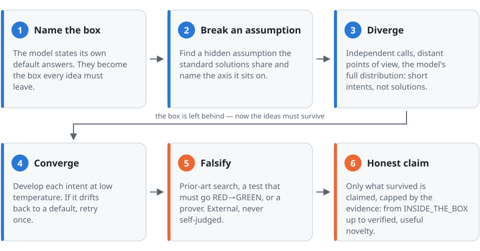

# The OUTLIER_MCB manual

**What this manual gives you:** in about an hour you go from installing the library to running it with a model on
your own machine or in the cloud, and you will know how to read every verdict it gives you.

**How it is built:** short lessons, each one a single skill. Every lesson has the same five parts, so you always
know where you are:

| | |
|---|---|
| 🎯 **Goal** | the one thing you will be able to do |
| ▶️ **Do** | the commands, copy-paste ready |
| 👀 **You will see** | the real output (captured from the library, not invented) |
| 💡 **Why it works** | the idea behind it, in plain words |
| ✅ **Check yourself** | one question, answer hidden until you open it |

Lessons 1–6 need **no model, no network and no API key**. Lessons 7–8 add a model. Lessons 9–10 close the loop.

---

## Map

| Level | Lesson | Time | Needs |
|---|---|---|---|
| Start | [0 · Install](#0--install) | 2 min | Python 3.9+ |
| Ideas | [1 · The whole method in one picture](#1--the-whole-method-in-one-picture) | 5 min | — |
| Offline | [2 · Ask for a brief](#2--ask-for-a-brief) | 5 min | — |
| Offline | [3 · Judge your own idea](#3--judge-your-own-idea) | 5 min | — |
| Offline | [4 · Never re-propose what already died](#4--never-re-propose-what-already-died) | 3 min | — |
| Offline | [5 · Check it is not already out there](#5--check-it-is-not-already-out-there) | 5 min | network optional |
| Offline | [6 · Give the engine semantic eyes](#6--give-the-engine-semantic-eyes) | 5 min | an embedding model |
| Model | [7 · Run it with a local model](#7--run-it-with-a-local-model) | 15 min | Ollama / llama.cpp / vLLM |
| Model | [8 · Run it with an online model](#8--run-it-with-an-online-model) | 10 min | an API key |
| Proof | [9 · Let a real test decide](#9--let-a-real-test-decide) | 10 min | a code repository |
| Proof | [10 · Measure it on your model](#10--measure-it-on-your-model) | hours, unattended | a local model |
| — | [Cheat sheet](#cheat-sheet) · [Verdicts](#every-verdict-in-one-table) · [Troubleshooting](#troubleshooting) · [Going further](#going-further) | | |

---

## 0 · Install

🎯 **Goal:** the library imports and answers.

▶️ **Do**

```bash
git clone https://github.com/massimiliano-caretti/OUTLIER_MCB.git
cd OUTLIER_MCB
pip install -e .              # zero runtime dependencies
# optional extras:
pip install -e ".[claude]"    # Claude, through the official Anthropic SDK
pip install -e ".[math]"      # SymPy, for exact symbolic checks of math claims
python -c "import OUTLIER_MCB as m; print(m.__version__)"
```

👀 **You will see** a version number, e.g. `2.1.0`.

💡 **Why it works:** the core is pure Python. Everything that needs a model, the network or a repository is
opt-in and named, so nothing heavy is installed or contacted unless you ask for it.

---

## 1 · The whole method in one picture

🎯 **Goal:** know the five words the rest of the manual uses.

<picture>
  <source media="(prefers-color-scheme: dark)" srcset="assets/pipeline-dark.svg">
  
</picture>

Ask a language model for "a new rate limiter" and it answers *token bucket*, *sliding window*, *leaky bucket*:
its **default answers**. Models do this on almost every open question, and different models converge on the same
few answers (*Artificial Hivemind*, NeurIPS 2025). OUTLIER_MCB is built around that fact.

| Word | Meaning | Example (rate limiter) |
|---|---|---|
| **the box** | the default answers and everything that only varies them | token bucket, sliding window, "token bucket with a bigger burst" |
| **hidden assumption** | something every standard solution silently takes for granted | "a limit is counted per time window" |
| **axis** | the kind of change that breaks it | REPRESENTATION: measure something else than time |
| **world-test** | the observation that would kill the new idea | "under bursty traffic it lets through more overload than a token bucket" |
| **honest claim** | the strongest statement the evidence allows, never more | "breaks `time_windowed`, not yet tested" |

✅ **Check yourself:** "a token bucket whose bucket size adapts to the client" — inside or outside the box?

<details><summary>Answer</summary>

Inside. It keeps the defining mechanism (a token bucket) and changes a parameter. In lesson 3 the library itself
classifies exactly this kind of idea as `NEAR_MODE` (a *component swap* of a default answer).
</details>

---

## 2 · Ask for a brief

🎯 **Goal:** before you answer a "new X" request, know which box to leave and which assumptions to break.

▶️ **Do**

```bash
python -m OUTLIER_MCB creative --problem "invent a new rate limiter for an API"
```

or, from Python:

```python
import OUTLIER_MCB as gsl
print(gsl.creative("invent a new rate limiter for an API"))
```

👀 **You will see** (first lines):

```text
1. Do NOT propose standard solutions from memory. This problem is closed in the box: the standard
   token/leaky/window limiter family (per-request, per-tenant, time-windowed).
2. Any idea that stays inside that box MUST be labelled INSIDE_THE_BOX and is not an answer.
3. The most promising assumptions to BREAK (with their exit axis):
     - tenant_independent  → break OBJECTIVE
     - time_windowed       → break REPRESENTATION
     - cost_uniform        → break COST_MODEL
5. Forbidden because they are collage / known-dead: fixed_window, gcra, leaky_bucket, queue_theory,
   sliding_window, token_bucket.
```

💡 **Why it works:** the domain knowledge lives in a **pack**: the box, its hidden assumptions and the known
families (built-in: `coding`, `math`, `generic`, `causal`, `numeric`, `meta`, `number_theory`, `physics`). The
engine itself knows nothing about rate limiters. It negates assumptions on named axes, so every direction it
suggests says *what* it changes.

> [!TIP]
> Unknown domain? The brief says so (`elicitation required`) instead of inventing a box. You can let the library
> induce a provisional pack (`invent(..., induce_pack=True)`) or describe one yourself (`gsl.pack_from_spec`).

✅ **Check yourself:** the brief recommends breaking `tenant_independent`. Is that an answer to the request?

<details><summary>Answer</summary>

No. It is a *direction*. The idea is still yours (or the model's). The brief only tells you which assumption to
break, and the next lessons test the idea you build on it.
</details>

---

## 3 · Judge your own idea

🎯 **Goal:** find out in one second whether an idea really leaves the box.

▶️ **Do** with two ideas, one obvious and one not:

```bash
python -m OUTLIER_MCB judge --problem "invent a new rate limiter" \
       --idea "use a token bucket per client"

python -m OUTLIER_MCB judge --problem "invent a new rate limiter" \
       --idea "price each request by the queue variance it adds
               instead of counting requests per time window"
```

👀 **You will see**

```text
# Judgment — «use a token bucket per client»
**verdict: INSIDE_THE_BOX** · maturity: INSIDE_THE_BOX
**next step:** name the hidden assumption your idea breaks (or the new output it produces).

# Judgment — «price each request by the queue variance it adds instead of counting requests per time window»
**verdict: MUST_BE_AUDITED** · maturity: SUSPENDED_BOLD · verifiability: HUMAN
breaks: time_windowed  (confidence 0.5)
**next step:** this is a HUMAN-class claim: BUILD the world its falsifier describes and judge it.
```

**Now add your own default answers (anti-mode).** Write the 3–5 answers *you* would give first. The judge
measures the idea against them:

```bash
python -m OUTLIER_MCB judge --problem "invent a new rate limiter" \
       --idea "a token bucket with a bigger burst" \
       --answer "token bucket per client" \
       --answer "sliding window counter" \
       --answer "fixed window counter"
```

```text
**verdict: INSIDE_THE_BOX**
vs declared mode: NEAR_MODE — drops window counter but is a component swap: it reuses «token bucket» of
«token bucket per client»
```

💡 **Why it works:** an idea counts as new only if it breaks an assumption *and* is not a variant of your default
answers. `MUST_BE_AUDITED` is **not** "novel". It means "worth testing", and the judge tells you what would kill
the idea. The three possible distances from your defaults are `MODE_ECHO` (the same thing), `NEAR_MODE` (a
variant) and `TAIL` (genuinely elsewhere). Only `TAIL` ideas should go on.

> [!IMPORTANT]
> Naming the box to negate it is fine. "Replace fixed window counters with …" is judged on what it *uses*, not on
> the words it rejects.

✅ **Check yourself:** an idea gets `MUST_BE_AUDITED`. Can you call it "a new rate limiter"?

<details><summary>Answer</summary>

Not yet. It breaks a real assumption, which makes it a candidate. "New" requires a prior-art check
(lesson 5), and "useful" requires surviving its test (lesson 9).
</details>

---

## 4 · Never re-propose what already died

🎯 **Goal:** the library remembers the ideas that were rejected and steers the next session away from them.

▶️ **Do** by adding a memory file to any command:

```bash
MEM=.outlier_mcb/failure_memory.json
python -m OUTLIER_MCB judge --problem "invent a new rate limiter" \
       --idea "use a token bucket per client" --memory $MEM
python -m OUTLIER_MCB creative --problem "invent a new rate limiter" --memory $MEM
```

or once for the whole shell: `export OUTLIER_MCB_MEMORY=.outlier_mcb/failure_memory.json`.

👀 **You will see** the second brief gain a block that starts with
`[memory] Already spent in this domain — do NOT re-propose` and lists `✗ idea: «use a token bucket per client»`.
When a rejected idea named the assumption it tried to break, that assumption is also ranked lower from then on.

💡 **Why it works:** every negative verdict (`INSIDE_THE_BOX`, `NEAR_MODE`, a rebrand of prior art, a candidate
the known family also passes) is written to a small JSON file. Briefs, judges and the model loop read it back.

---

## 5 · Check it is not already out there

🎯 **Goal:** catch ideas that already exist under another name.

▶️ **Do.** Offline first (a curated corpus of about 40 well-known methods, no network):

```python
import OUTLIER_MCB as gsl
offline = gsl.OfflineCorpusProvider()

v = gsl.novelty_audit("a token bucket that refills at a fixed rate per client", offline)
print(v.status, v.novelty_scope)        # RENAMED  OFFLINE_CORPUS_CHECKED

v = gsl.novelty_audit("price each request by the queue variance it adds", offline)
print(v.status, v.novelty_scope)        # NO_PRIOR_ART_FOUND  OFFLINE_CORPUS_CHECKED
```

Then online (arXiv and OpenAlex, no key needed):

```python
online = gsl.CompositePriorArtProvider([gsl.ArxivPriorArtProvider(), gsl.OpenAlexProvider()])
idea = "price each request by the queue variance it adds"
print(gsl.novelty_audit(idea, online).markdown())
```

💡 **Why it works:** the verdict is graded (`RENAMED`, `COLLAGE`, `NO_PRIOR_ART_FOUND`) and always carries its
**scope**: what was actually searched.

| scope | means | the strongest claim allowed |
|---|---|---|
| `LOCAL_ONLY` | nothing external was searched | weakly novel |
| `OFFLINE_CORPUS_CHECKED` | the built-in corpus was searched | not a known famous method |
| `INCOMPLETE_ONLINE_SEARCH` | online sources were configured but failed | reported as incomplete, never faked |
| `ONLINE_PRIOR_ART_CHECKED` | at least one online source answered | provisionally novel *on the checked sources* |

> [!WARNING]
> `NO_PRIOR_ART_FOUND` means *not found where we looked*. The library never turns it into "never seen before".

---

## 6 · Give the engine semantic eyes

🎯 **Goal:** "different words, same idea" is recognised as the same idea.

By default distances are lexical: they compare words. That is deterministic and dependency-free, but it misses a
reworded copy. One switch upgrades every distance in the engine (novelty, duplicates, anti-mode, memory):

▶️ **Do**, with any of:

```bash
ollama pull nomic-embed-text
# via Ollama
export OUTLIER_MCB_EMBEDDER=ollama:nomic-embed-text
# or via sentence-transformers
export OUTLIER_MCB_EMBEDDER=sentence-transformers:all-MiniLM-L6-v2
```

or in Python: `gsl.set_default_embedder(my_embedder)` (see `OUTLIER_MCB.embeddings.CallableEmbedder`).

💡 **Why it works:** if the model is unreachable, the library falls back to lexical distance instead of failing.
Everything above keeps working; it just sees less.

---

## 7 · Run it with a local model

🎯 **Goal:** a model on your machine proposes the ideas, and OUTLIER_MCB takes it out of its default answers.

▶️ **Do** with Ollama ([ollama.com](https://ollama.com)):

```bash
ollama pull qwen3:8b                 # any instruct model you like; small ones work
ollama pull nomic-embed-text         # for semantic distances (lesson 6)
export OUTLIER_MCB_EMBEDDER=ollama:nomic-embed-text
python -m OUTLIER_MCB llm-search --llm ollama:qwen3:8b \
       --problem "invent a new way to rate-limit the clients of an API" \
       --budget 4 --samples-per-round 4
```

or from Python:

```python
import OUTLIER_MCB as gsl
llm = gsl.OllamaLLMProvider("qwen3:8b")
res = gsl.llm_openended_search("invent a new way to rate-limit the clients of an API", llm,
                               budget=4, samples_per_round=4)
print(res.markdown())
```

👀 **You will see** a report with these lines (real run, `qwen3.5:4b`, shortened with …):

```text
- divergent phase: mode=elicited (5 default answers denied) · intents generated/selected: 15/3 · … · fallback rounds: 0
- sampler: diverge T=1.0 {'top_p': 0.95, 'top_k': 0} · converge T=0.2
```

and the candidates in `res.candidates`, for example *Probabilistic Gossip Throttling* ("rate limits are enforced
via a decentralized gossip protocol where nodes adjust throttle factors …") and *Geodesic Decay Rate Limiter*
("capacity decays geometrically with each hop through the service mesh …").

**What happened, step by step** (the six steps of lesson 1):

1. **The box.** One cool call asks the model for its own default answers (token bucket, leaky bucket, …).
2. **Diverge.** Three independent calls, each from a distant point of view (a physicist, an economist, an
   adversary, …), each writing observations and then short *intents*. Sampling is hot (T = 1, a nucleus cut, no
   top-k).
3. **Filter.** Intents that echo a default answer, repeat each other or match something already known are
   dropped before any more calls are spent. The survivors are spread across different assumptions.
4. **Converge.** Each intent is developed at T = 0.2 into a full candidate. If the development drifts back into a
   default answer, it is retried once. Invalid JSON is repaired.
5. **Falsify.** Every candidate goes through the prior-art gate and, if you ask for it, a real test (lesson 9).

> [!NOTE]
> These steps come from published work (Intent Factored Generation, PlanSearch, persona studies, denial
> prompting, novelty search, MAP-Elites) and were **measured on a local model** (lesson 10). Two of them, the
> verbalized tail and listing the defaults in the prompt, made results worse on that model, so they are off by
> default and available as options.

**Squeeze more out of a local model.** These levers exist only locally:

| lever | how | when |
|---|---|---|
| a **base** (non-chat) model for the divergent phase | `gsl.RoleRoutedLLM(gsl.OllamaLLMProvider("qwen3:8b"), diverge=gsl.OllamaLLMProvider("<base-model>", completion=True))` or `OUTLIER_MCB_LLM_DIVERGE=ollama-raw:<base-model>` | base models are measurably less mode-collapsed (West & Potts 2025) |
| truncation samplers | `divergence=gsl.DivergenceConfig(diverge_sampling={"min_p": 0.05})` | to push temperature higher while staying coherent (min_p's benefit is disputed; Ollama ignores `top_n_sigma`) |
| reproducible runs | `gsl.DivergenceConfig(seed=7)` | every call gets its own seed derived from it |
| llama.cpp / vLLM / LM Studio | `--llm openai:<model>@http://localhost:8080/v1` | same features, local samplers like `top_n_sigma` included |

**Turn techniques on or off** with `gsl.DivergenceConfig(...)`: `auto_mode`, `personas`, `observations_first`,
`verbalized_tail`, `denial_in_prompt`, `novelty_min_distance`, `drift_retries`, `converge_json_repairs`,
`diverge_temperature`, `converge_temperature`. `divergence=False` goes back to the single-call loop.

✅ **Check yourself:** the report says `intents generated/selected: 15/0 · fallback rounds: 1`. What happened?

<details><summary>Answer</summary>

Every intent was filtered out (all echoes or duplicates), so that round fell back to a single cool call. Look at
the `rejected:` counts in the same line. Many `MODE` rejections mean the model keeps returning to its defaults:
try a base model for the divergent phase, or a different model.
</details>

---

## 8 · Run it with an online model

🎯 **Goal:** the same loop with Claude, OpenAI, Gemini, OpenRouter, Mistral, DeepSeek or Groq.

▶️ **Do**

```bash
# Claude: pip install -e ".[claude]"
# credentials: ANTHROPIC_API_KEY, or a profile from `ant auth login`
python -m OUTLIER_MCB llm-search --llm claude: \
       --problem "invent a new way to rate-limit the clients of an API"

# OpenAI-compatible APIs: each one reads its own key
export OPENAI_API_KEY=…
python -m OUTLIER_MCB llm-search --llm openai:<model> --problem "…"
export GEMINI_API_KEY=…
python -m OUTLIER_MCB llm-search --llm gemini:<model> --problem "…"
# also: openrouter:<model> · mistral:<model> · deepseek:<model> · groq:<model>
```

```python
# Claude Opus 5.5 by default; effort="high" to go deeper
llm = gsl.AnthropicLLMProvider(effort="high")

# "openai", "gemini", "openrouter", "mistral", "deepseek" or "groq"
llm = gsl.online_provider("openai", "<model>")
```

💡 **What changes online, and why.** The prompt-level techniques work with every model. The sampler does not:

| lever | local | OpenAI-compatible | Claude (current models) |
|---|---|---|---|
| anti-mode, points of view, filters, drift retry | ✓ | ✓ | ✓ |
| hot diverge / cool converge temperature | ✓ | ✓ (reasoning models refuse it: learned from the first error, then dropped) | ✗ (not accepted by current models) |
| nucleus cut / top-k / min_p | ✓ | top_p only | ✗ |
| base model in raw completion | ✓ | ✗ | ✗ |
| per-sample seeds | ✓ | ✓ | ✗ |

The report always says which levers were real. When a provider refuses a temperature, you will read
`sampler: the provider does not take a temperature — prompt-level divergence only`.

> [!NOTE]
> Claude requests use the server-side refusal fallback on the models that support it (`fallbacks=False` turns it
> off). A refused or failed sample never crashes the search: it is discarded, and the reason shows up as
> `provider error` in the report.

> [!WARNING]
> Cost. Each round makes about 1 (defaults, once) + 3 (divergent) + K (one per developed intent) calls, plus up to
> one retry per intent. Start with `--budget 4 --samples-per-round 4`.

---

## 9 · Let a real test decide

🎯 **Goal:** an idea about code wins only if it makes a new failing test pass.

▶️ **Do** inside a Python repository that uses pytest:

```python
res = gsl.llm_openended_search("invent a faster cache invalidation for this service", llm,
                               repo_path=".", materialize=True, budget=8)
print(res.markdown())
```

> [!WARNING]
> A winning test + patch is **written into your working tree** so you can review it with `git diff`; failed
> attempts are rolled back. Commit or stash your work first, or pass `dry_run=True` to roll back everything.

💡 **Why it works:** for each candidate the model writes a test and a patch as unified diffs. The library applies
them **in a transaction** and runs the test twice:

1. **before** the patch, the test must fail for the right reason (`RED_ASSERTION`, not a broken import);
2. **after** the patch, it must pass (`GREEN`), with a patch that changes real code instead of weakening the test;
3. the strongest known family (`baseline_patch`) must still fail the test. Otherwise the idea is
   `NOT_SEPARATED` from what already exists.

The winner is picked by this external evidence, never by the model's own opinion of its idea.

---

## 10 · Measure it on your model

🎯 **Goal:** know, with numbers, whether OUTLIER_MCB helps *your* model.

▶️ **Do** (it runs unattended for a few hours and resumes if interrupted):

```bash
python -m evals.divergence_ab --llm ollama:qwen3:8b \
       --embedder ollama:nomic-embed-text --out evals/reports/my_run

# rebuild the report at any time
python -m evals.divergence_ab --out evals/reports/my_run --report-only
```

👀 **You will see** `report.md` with three conditions (the model's direct answer, the OUTLIER loop, the
divergent phase) and one ablation per technique. Every value comes with a 95% interval.

| metric | question it answers |
|---|---|
| `tail_rate` | what share of the ideas leaves the model's own default answers? |
| `mode_dist` | how far from those defaults? |
| `spread`, `distinct` | how different from each other? |
| `n_ideas`, `calls`, `secs` | at what cost? |

> [!IMPORTANT]
> An interval that contains 0 is not evidence of an effect in either direction. These metrics measure *leaving
> the box*, not usefulness. Usefulness is decided by lesson 9.

---

## Cheat sheet

**Provider specs** (`--llm …`, `OUTLIER_MCB_LLM=…`)

| spec | provider |
|---|---|
| `ollama:<model>[@<host>]` | Ollama, chat |
| `ollama-raw:<model>[@<host>]` | Ollama, raw completion (base models) |
| `openai:<model>@<base_url>` | any OpenAI-compatible server (llama.cpp, vLLM, LM Studio) |
| `openai-raw:<model>@<base_url>` | the same, `/completions` (base models) |
| `openai:<model>` | the OpenAI API |
| `claude:[<model>]` · `anthropic:…` | Claude (official SDK) |
| `gemini:` · `openrouter:` · `mistral:` · `deepseek:` · `groq:<model>` | hosted OpenAI-compatible APIs |
| `subprocess:<command>` | any CLI that reads the prompt on stdin (`{temperature}` placeholder supported) |

**Environment variables**

| variable | effect |
|---|---|
| `OUTLIER_MCB_LLM` | default model for every generative entry point |
| `OUTLIER_MCB_LLM_DIVERGE` | a different model for the divergent phase (e.g. a base model) |
| `OUTLIER_MCB_EMBEDDER` | semantic distances everywhere (`ollama:…`, `sentence-transformers:…`) |
| `OUTLIER_MCB_MEMORY` | failure-memory file shared by every command |
| `OLLAMA_HOST` | Ollama address (default `http://localhost:11434`) |
| `ANTHROPIC_API_KEY`, `OPENAI_API_KEY`, `GEMINI_API_KEY`, `OPENROUTER_API_KEY`, `MISTRAL_API_KEY`, `DEEPSEEK_API_KEY`, `GROQ_API_KEY`, `OUTLIER_MCB_LLM_API_KEY` | credentials (the last one for a custom OpenAI-compatible server) |

**Commands** (`python -m OUTLIER_MCB <command> --help` for all options)

| command | does |
|---|---|
| `creative --problem …` | the brief (lesson 2) |
| `judge --idea … --problem … [--answer …]` | judge an idea, optionally against your defaults (lesson 3) |
| `mode --problem … --answer … [--idea …]` | mine the box from your default answers |
| `route --problem … --json` | per-turn activation decision for assistants |
| `llm-search --llm … --problem …` | the model loop (lessons 7–9) |
| `explore --problem …` | the full front door: route → generate → settle → audit |

## Every verdict in one table

| verdict | where | meaning |
|---|---|---|
| `INSIDE_THE_BOX` | judge | breaks no assumption, or only varies a default answer |
| `MUST_BE_AUDITED` | judge | breaks a real assumption: worth testing, not yet novel |
| `DEAD_BY_BARRIER` | judge | a known impossibility result already rules this route out |
| `MODE_ECHO` / `NEAR_MODE` / `TAIL` | anti-mode | the same as / a variant of / genuinely away from your defaults |
| `RENAMED` / `COLLAGE` / `NO_PRIOR_ART_FOUND` | prior art | exists under another name / covered by a union of works / not found where searched |
| `RED_ASSERTION` → `GREEN` | test | failed for the right reason, then passed after a real patch |
| `RED_COLLECTION` | test | failed for the wrong reason (import or syntax error): proves nothing |
| `NOT_SEPARATED` | test | the best known method also passes the test |

## Troubleshooting

| symptom | cause and fix |
|---|---|
| `provider error (samples discarded): … Connection refused` | the local server is not running: `ollama serve`, or check `OLLAMA_HOST` |
| `no API key: set OPENAI_API_KEY` | export the key named in the message |
| `the Anthropic SDK is not installed` | `pip install -e ".[claude]"` |
| candidates `valid/discarded: 0/4` | the model is not returning JSON: use a larger instruct model, or raise `max_json_repairs` |
| many `MODE` rejections, few ideas | the model keeps returning to its defaults: try a base model for the divergent phase (lesson 7) |
| empty answers from a reasoning model | Ollama providers send `think: false` by default; for OpenAI-compatible servers, prefer a non-reasoning model for the converge role |
| slow | a 4B model takes ~1 min per divergent call; use `--budget 4`, a smaller converge model via `RoleRoutedLLM`, or a GPU |

## Going further

The [technical reference](REFERENCE.md) covers what this manual leaves out:

- autonomous discovery from data;
- external provers (z3, cvc5, Vampire, Isabelle, Lean, PARI);
- the hard-problem frontier;
- self-improvement under a no-regression gate;
- the official benchmarks and how the engine compares with FunSearch, AlphaEvolve and MAP-Elites.

To see every entry point at once:

```bash
python -c "import OUTLIER_MCB as m; print(m.capabilities_markdown())"
```
